# NampungYuk

Platform showcase karya programmer dan wadah kolaborasi komunitas developer. NampungYuk dirancang untuk memamerkan proyek perangkat lunak, mendokumentasikan proses belajar, berdiskusi lewat komunitas & live audio/video **Spaces**, serta membangun jaringan antardeveloper di Indonesia dalam antarmuka **Token Harbor** (Dark Mode Only).

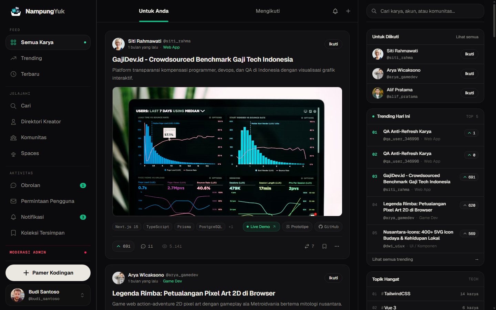

---

## Daftar Isi

1. [Tentang Platform](#tentang-platform)
2. [Fitur Utama](#fitur-utama)
3. [Tangkapan Layar & Pratinjau](#tangkapan-layar--pratinjau)
4. [Teknologi yang Digunakan](#teknologi-yang-digunakan)
5. [Prasyarat Sistem](#prasyarat-sistem)
6. [Panduan Instalasi Lokal](#panduan-instalasi-lokal)
7. [Konfigurasi Environment (.env)](#konfigurasi-environment-env)
8. [Pengujian Aplikasi](#pengujian-aplikasi)
9. [Struktur Direktori Utama](#struktur-direktori-utama)
10. [Lisensi](#lisensi)

---

## Tentang Platform

NampungYuk hadir sebagai solusi bagi para pengembang aplikasi untuk tidak hanya sekadar menyimpan repositori kode, tetapi juga memamerkan produk yang siap dinilai, dicoba, dan didiskusikan oleh komunitas. Setiap karya yang diunggah memuat informasi komprehensif, mulai dari tech stack, arsitektur, cara instalasi lokal, hingga tantangan dan pembelajaran berharga selama proses pembuatan.

---

## Fitur Utama

### 1. Showcase Proyek & Feed Interaktif
- Penelusuran proyek berdasarkan tab **Untuk Anda / Trending**, **Terbaru**, dan **Mengikuti** (auth).
- Pencarian global bertab (`/cari`) serta filter kategori kodingan dan tech stack (tagar teknologi).
- Sistem apresiasi seragam dengan panah **Upvote (`^`)** dan kalkulasi skor reputasi kreator.
- Fitur **Koleksi Tersimpan** (bookmark), **Repost** karya, serta komentar bersarang (nested thread).

### 2. Composer Anti-Refresh, Sistem Draft & Detail Karya
- **Auto-Save & Anti-Refresh Error**: Composer `/unggah` menyimpan state ke `localStorage` dan menyinkronkannya otomatis ke database via `POST /unggah/autosave` (debounce & `sendBeacon` saat refresh/tutup tab). Validasi URL dan submit memakai AJAX `fetch` sehingga kesalahan input tidak me-refresh halaman atau menghilangkan file gambar yang sudah dipilih.
- **Auto-Normalisasi HTTPS**: Domain polos berformat valid pada `demo_url` / `github_url` otomatis dilengkapi awalan `https://`, sementara skema berbahaya (`javascript:`, dll.) tetap ditolak.
- **Kelola Draft (`/draft`)**: Simpan manual via tombol **Simpan ke Draft**, lanjutkan pengeditan, publikasikan langsung, atau pindahkan karya dari/ke mode Draft lewat `/project/{slug}/edit` dan tab **Draft** di profil.
- **Detail Teknis Lengkap**: Live demo, repositori GitHub, prototipe interaktif (Figma), tantangan teknis, pelajaran berharga, cara run di lokal, galeri gambar (WebP), dan video demo.

### 3. Spaces Live Audio & Video Terstruktur (X-Style)
- **Gerbang Host Kreator**: Pembuatan Space dibatasi untuk Admin atau kreator terverifikasi yang memenuhi syarat reputasi (`>= 100` pengikut, `>= 3` karya publik aktif, `>= 100` poin reputasi, link GitHub/Website, dan bebas catatan moderasi).
- **Siklus & Panggung Terstruktur**: Mendukung Space langsung maupun terjadwal (`scheduled`), penyematan karya bahasan (`pinned_project_id`), pemisahan **Panggung** (`Host`, `Co-host` maks. 2, `Speaker` maks. 10) vs **Pendengar** (`Listener`), alur **Angkat Tangan**, persetujuan naik panggung, mute paksa, turun panggung, kick, reaksi cepat, dan Obrolan Ruang.
- **Offline & Local-Ready**: Mendukung Laravel Reverb WebSocket maupun fallback polling HTTP (`/spaces/{space}/sync`) serta WebRTC lokal tanpa memerlukan STUN eksternal saat berjalan di jaringan lokal.

### 4. Komunitas Developer & Tata Kelola (Facebook Groups-Style)
- Pembuatan grup komunitas baru mensyaratkan minimal `100` pengikut (atau akses Admin).
- Sistem peran berlapis (**Owner**, **Admin**, **Moderator**, **Member**) dengan konsol pengelolaan `/komunitas/{slug}/kelola`: pertanyaan gabung & antrean persetujuan anggota, persetujuan postingan, pin & kunci komentar, tanya-jawab (Q&A) berpenanda terjawab, mute/kick/ban, transfer kepemilikan, dan audit log.

### 5. Obrolan Antar Pengguna & Profil Kreator
- **Obrolan 2-Pane (`/obrolan`)**: Layout workspace penuh dengan sidebar ringkas `72px`, badge unread realtime, typing indicator, read receipts, dan 2 mode kebijakan privasi DM (`everyone` / `following_only`) dengan gerbang permintaan pesan monotonik.
- **Profil Kreator (`/@username`)**: Banner & avatar custom crop, link-in-bio, stat terminal (reputasi, karya, pengikut, mengikuti), lencana relasi sosial (*Mengikutimu* / *Teman*), serta hingga 3 karya disematkan.

### 6. Autentikasi Terverifikasi & Moderasi Admin
- **Pendaftaran & Verifikasi Email**: Registrasi manual dengan aktivasi email sebelum login, reset password berbasis kode OTP, serta **Login Google (OAuth)** via Laravel Socialite.
- **Dashboard Moderasi (`/admin/laporan`)**: Tinjau laporan konten/akun, beri peringatan (menyembunyikan karya dari publik), blokir (ban) pengguna, hingga hapus proyek bermasalah.

---

## Tangkapan Layar & Pratinjau

Seluruh tangkapan layar antarmuka disimpan dalam direktori `docs/images/`.

### 1. Halaman Beranda & Feed Utama


### 2. Halaman Detail Karya & Dokumentasi Teknis
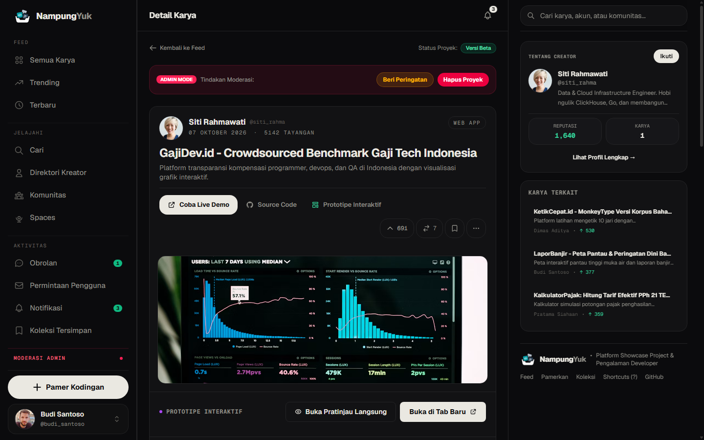

### 3. Formulir Unggah Karya (Composer Anti-Refresh & Draft)
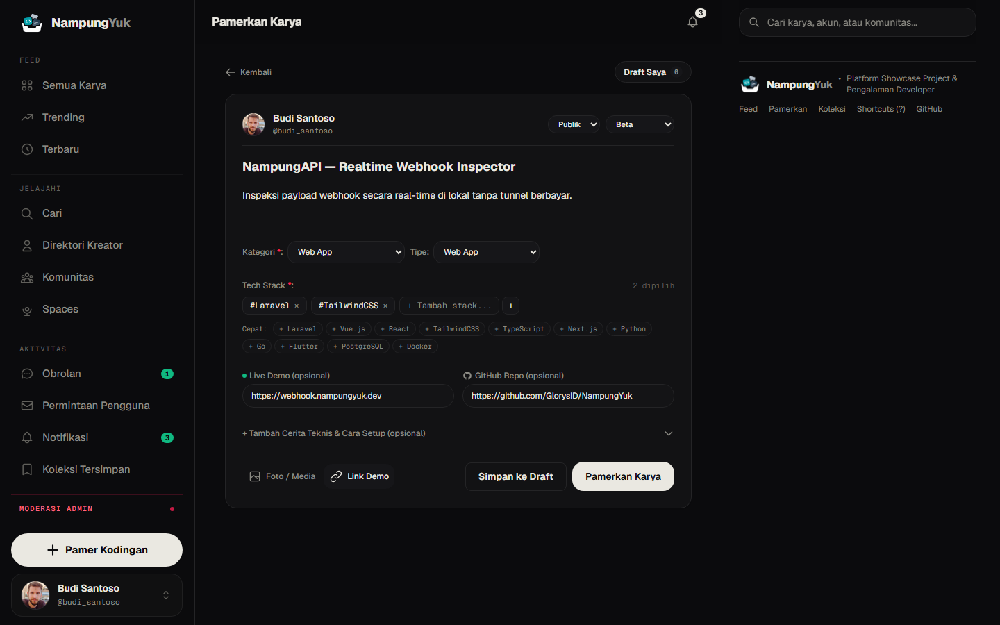

### 4. Halaman Daftar Draft Karya
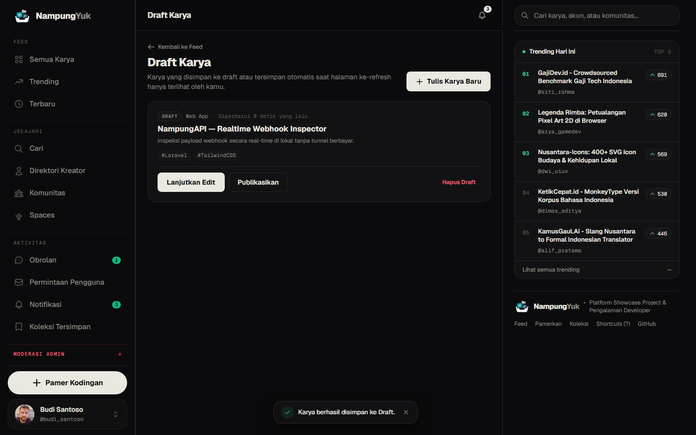

### 5. Spaces Live Audio & Video Terstruktur
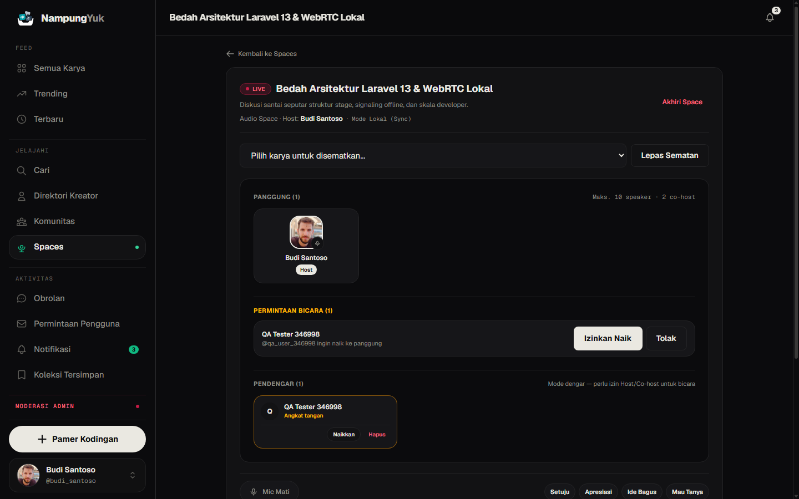

### 6. Halaman Komunitas & Diskusi Developer
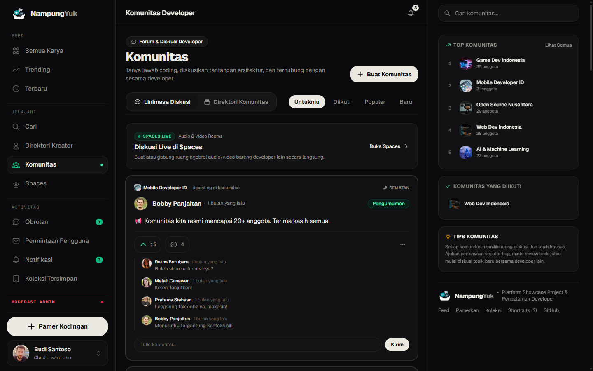

### 7. Fitur Obrolan Developer (Workspace 2-Pane)
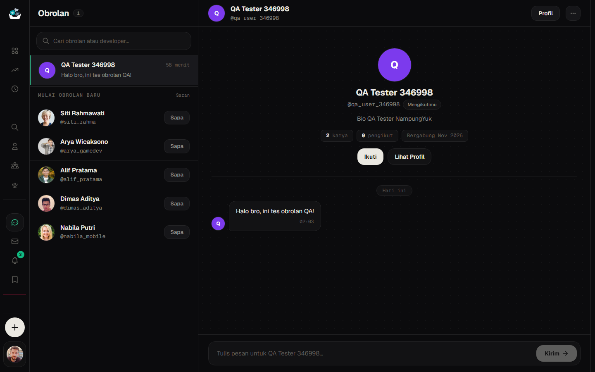

### 8. Halaman Profil Kreator
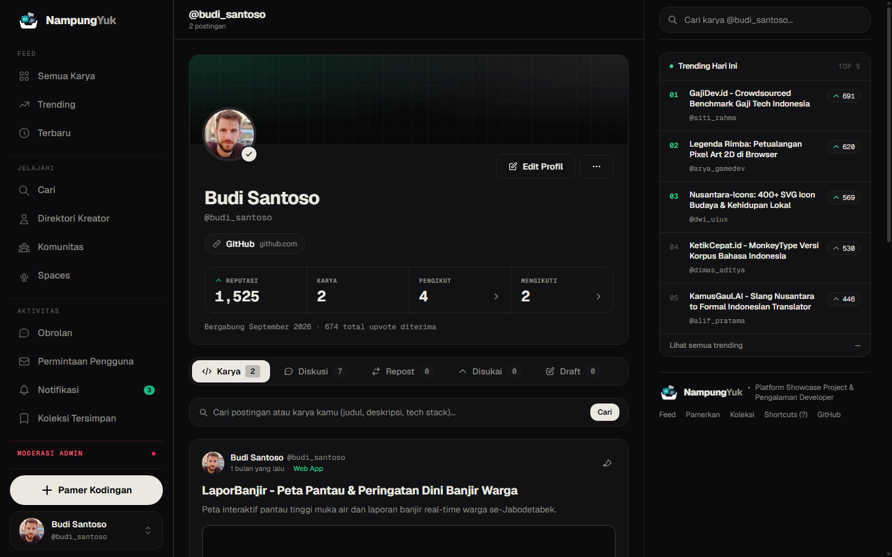

### 9. Autentikasi Split-Screen
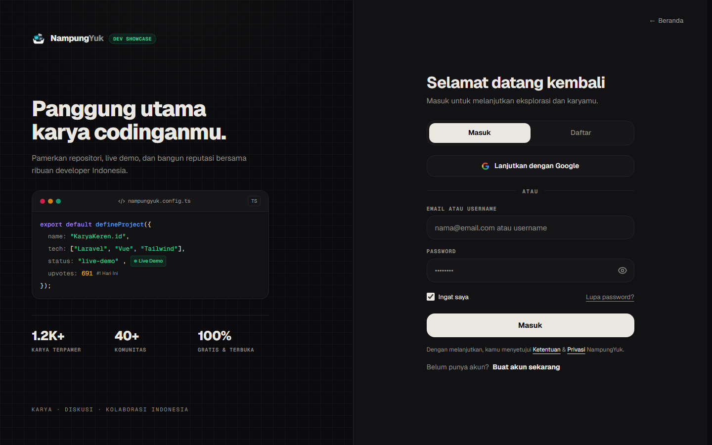

### 10. Dashboard Moderasi Administrator
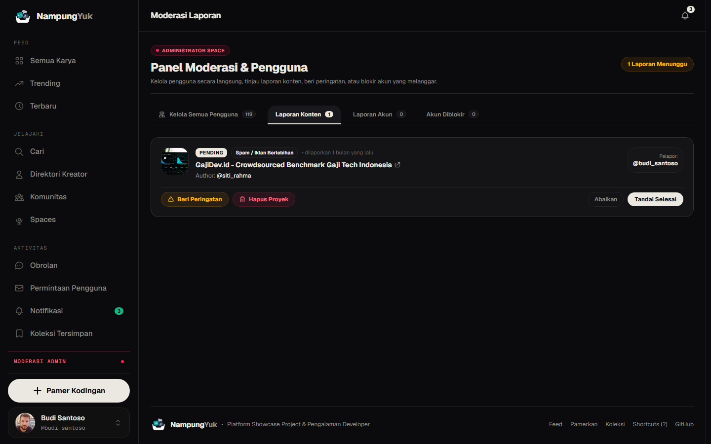

### 11. Tampilan Responsif Mobile (Dark Mode Only)
Platform mengadopsi estetika **Token Harbor** yang dirancang **Dark Mode Only** (Matte Obsidian `#0B0B0D`, Surface `#121214`, Hairline Border `#242426`, Warm Stone `#EAE8E1`, dan tipografi Geist / Geist Mono).
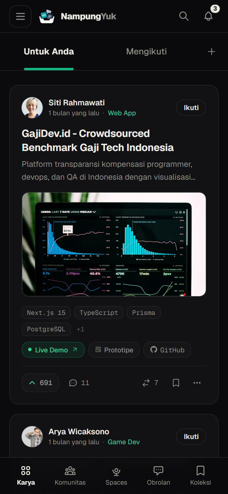

---

## Teknologi yang Digunakan

- **Bahasa Pemrograman:** PHP 8.3+
- **Framework Backend:** Laravel 13 (`v13.30.1`)
- **Frontend & UI:** Blade Templates, Tailwind CSS v4, Alpine.js, Vite v8
- **Basis Data:** SQLite (default lokal dev & test) / MySQL 8.4 (opsional)
- **Autentikasi Eksternal:** Laravel Socialite (Google OAuth 2.0)
- **Layanan Realtime & Media:** Laravel Reverb (WebSockets + fallback polling HTTP) & WebRTC P2P
- **Kompresi Media:** PHP GD (WebP) & FFmpeg CLI (H.264 Video) via `App\Services\MediaOptimizer`
- **Testing & Code Style:** PHPUnit 12 (**264 tests, 1.309 assertions**) & Laravel Pint

---

## Prasyarat Sistem

Sebelum menjalankan proyek di komputer lokal, pastikan perangkat Anda telah terpasang:

1. **PHP:** Versi 8.3 atau lebih baru (dengan ekstensi `pdo_sqlite`, `pdo_mysql`, `mbstring`, `fileinfo`, `gd` aktif). Pada lingkungan Laragon Windows, gunakan binary PHP 8.3 (`C:\laragon\bin\php\php-8.3.30-Win32-vs16-x64\php.exe`).
2. **Composer:** Versi 2.x
3. **Node.js:** Versi 20.x / 24.x dan **npm**
4. **Git**

---

## Panduan Instalasi Lokal

Ikuti langkah-langkah berikut untuk memasang proyek dari repositori:

### 1. Klon Repositori
```bash
git clone https://github.com/GlorysID/NampungYuk.git
cd NampungYuk
```

### 2. Pasang Dependensi Backend (PHP)
```bash
composer install
```

### 3. Pasang Dependensi Frontend (JavaScript & CSS)
```bash
npm install
```

### 4. Salin Berkas Konfigurasi Lingkungan
```bash
copy .env.example .env
```
*(Gunakan `cp .env.example .env` jika menggunakan Linux/macOS).*

### 5. Generate Application Key
```bash
php artisan key:generate
```

### 6. Buat Tautan Penyimpanan Media (Storage Symlink)
```bash
php artisan storage:link
```

### 7. Jalankan Migrasi & Seeder Database
Secara default, NampungYuk menggunakan SQLite lokal yang langsung siap digunakan tanpa memerlukan server database terpisah:
```bash
php artisan migrate --seed
```
> Akun demo bawaan hasil seeder: `@budi_santoso` (Admin, password `password`) dan `@siti_rahma` (password `password`).

### 8. Kompilasi Aset Frontend
Untuk mode pengembangan aktif (HMR):
```bash
npm run dev
```
Atau untuk build produksi:
```bash
npm run build
```

### 9. Jalankan Server Pengembangan
Buka terminal baru dan jalankan:
```bash
php artisan serve
```
*(Opsional untuk WebSocket realtime instan tanpa fallback polling)*:
```bash
php artisan reverb:start
```
Akses aplikasi melalui browser di alamat: `http://localhost:8000`.

---

## Konfigurasi Environment (.env)

Berikut penjelasan parameter konfigurasi utama pada berkas `.env`:

### 1. Basis Data (Database)

#### Menggunakan SQLite (Rekomendasi Cepat / Bawaan):
```env
DB_CONNECTION=sqlite
# Parameter DB_HOST, DB_PORT, DB_DATABASE dapat dikomentari
```

#### Menggunakan MySQL:
```env
DB_CONNECTION=mysql
DB_HOST=127.0.0.1
DB_PORT=3306
DB_DATABASE=nampungyuk
DB_USERNAME=root
DB_PASSWORD=
```

### 2. Pengiriman Email (Mail Server)

#### Mode Pengujian Lokal (Tercatat di Log):
```env
MAIL_MAILER=log
MAIL_FROM_ADDRESS="no-reply@nampungyuk.com"
MAIL_FROM_NAME="NampungYuk"
```
*Tautan verifikasi email dan reset password dapat dilihat di berkas `storage/logs/laravel.log`.*

#### Pengiriman Email Sungguhan (SMTP / Gmail / Mailtrap):
```env
MAIL_MAILER=smtp
MAIL_HOST=smtp.gmail.com
MAIL_PORT=587
MAIL_USERNAME=alamat_email_anda@gmail.com
MAIL_PASSWORD=app_password_16_digit_gmail
MAIL_ENCRYPTION=tls
MAIL_FROM_ADDRESS="no-reply@nampungyuk.com"
MAIL_FROM_NAME="NampungYuk"
```

### 3. Login dengan Google (Google OAuth)
Dapatkan kredensial OAuth dari [Google Cloud Console](https://console.cloud.google.com/):
```env
GOOGLE_CLIENT_ID=your-google-client-id.apps.googleusercontent.com
GOOGLE_CLIENT_SECRET=your-google-client-secret
GOOGLE_REDIRECT_URI=http://localhost:8000/auth/google/callback
```

---

## Pengujian Aplikasi

Proyek ini dilengkapi dengan cakupan pengujian unit dan fitur komprehensif menggunakan PHPUnit (264 tests, 1.309 assertions):

```bash
# Menjalankan seluruh pengujian
php artisan test --compact

# Menjalankan pengujian untuk fitur tertentu
php artisan test --filter=ProjectShowcaseTest
php artisan test --filter=ProjectDraftsTest
php artisan test --filter=BackendSecurityAndSpacesTest
php artisan test --filter=CommunityManagementTest
```

Untuk memastikan konsistensi gaya penulisan kode sesuai standar Laravel:
```bash
php vendor/bin/pint --dirty --format agent
```

---

## Struktur Direktori Utama

```text
NampungYuk/
├── app/
│   ├── Events/                                 # Broadcast events (SpaceSignal, MessageSent, ProjectPublished)
│   ├── Http/
│   │   ├── Controllers/
│   │   │   ├── AdminModerationController.php   # Moderasi laporan & pengguna
│   │   │   ├── Auth/                           # Login, register, oauth, verifikasi email, OTP password
│   │   │   ├── ChatController.php              # Obrolan langsung, sync, typing, read receipt
│   │   │   ├── CommunityController.php         # Direktori, feed komunitas, keanggotaan
│   │   │   ├── CommunityManagementController.php # Konsol kelola komunitas ala FB Groups
│   │   │   ├── ProfileController.php           # Profil kreator & daftar pengikut/mengikuti
│   │   │   ├── ProjectController.php           # Showcase, draft, autosave, edit, hapus karya
│   │   │   └── SpaceController.php             # Spaces audio/video, stage, angkat tangan, WebRTC sync
│   │   └── Middleware/                         # Proteksi admin & status banned
│   ├── Models/                                 # Model Eloquent (User, Project, Community, Space, dll.)
│   └── Services/                               # MediaOptimizer & business logic
├── database/
│   ├── factories/                              # Factory data testing
│   ├── migrations/                             # Skema tabel database
│   └── seeders/                                # Seeder data demo awal
├── docs/
│   └── images/                                 # Tangkapan layar aplikasi untuk README
├── resources/
│   ├── css/                                    # Token desain & stylesheet Tailwind v4
│   ├── js/                                     # Alpine.js components (spaceRoom, chatRoom, dll.)
│   └── views/                                  # Template Blade halaman antarmuka
├── routes/
│   ├── channels.php                            # Broadcast authorization channels
│   ├── console.php                             # Perintah artisan kustom
│   └── web.php                                 # Rute navigasi web aplikasi
└── tests/                                      # Pengujian fitur & unit (PHPUnit)
```

---

## Lisensi

Proyek NampungYuk dilisensikan di bawah lisensi terbuka [MIT](LICENSE). Anda bebas menggunakan, memodifikasi, dan mengembangkan kode sumber ini sesuai kebutuhan.
